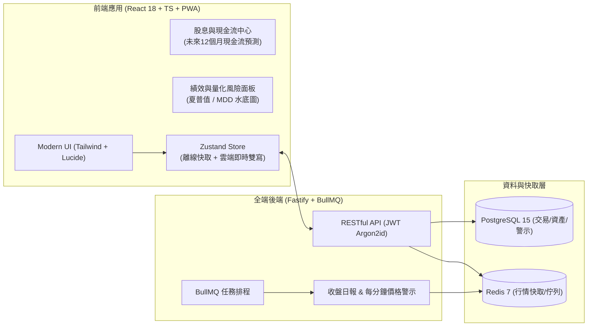

# Stocktify｜專業美股台股全端投資管理系統

[](package.json)
[](docs/fullstack-optimization-spec.md)
[](LICENSE)

Stocktify 是一套專為美股與台股長期投資者打造的**全端個人資產管理系統**。具備券商等級的加權平均成本會計引擎、股息現金流預測、量化風險評估（夏普值、最大回撤 MDD）、多裝置即時雲端雙寫與 BullMQ 背景自動推播（支援 LINE 官方帳號及 Discord / Telegram Webhook）。

---

## 🚀 核心功能亮點



### 1. 💼 投資組合與加權成本記帳引擎
* **先進加權平均成本算法**：每次買進自動更新平均成本，賣出精確結算已實現損益（Realized PnL）。
* **即時雲端雙寫（Online-first with local fallback）**：已登入時自動同步至 PostgreSQL 資料庫；斷網時無縫降級至本地 localStorage，並在登入或重連後自動雙向同步。
* **快捷記帳視窗 (`QuickTradeModal`)**：全域快速呼叫下單彈窗，即時試算賣出損益與手續費折讓。

### 2. 💰 股息與被動現金流中心 (`/dividends`)
* **未來 12 個月現金流預測長條圖**：視覺化預估 1～12 月每月預期進帳之股息被動收入。
* **持股殖利率矩陣**：即時對比「現價殖利率」與「持有成本殖利率 (Yield on Cost, YoC)」。
* **除息歷程與對帳清單**：自動回測歷史持股在除息日的實際入帳紀錄。

### 3. 📈 績效與量化風險面板 (`/analytics`)
* **專業量化風險指標**：夏普值 (Sharpe Ratio)、最大回撤 (MDD, Maximum Drawdown)、年化波動度 (Volatility)、貝他係數 (Beta) 及索提諾比率 (Sortino Ratio)。
* **大盤基準對比走勢圖**：以 0.00% 為基準起點，與 S&P 500 (`^GSPC`)、元大台灣50 (`0050.TW`)、那斯達克等大盤累積報酬率對標。
* **歷史回撤水底圖 (Underwater Chart)**：清楚洞察波段回調深度與修復歷程。

### 4. 🔔 背景自動排程與多管道推播中心 (`/settings/line`)
* **多管道推播**：支援 LINE 官方帳號 Flex Message 卡片，並整合 **Discord / Telegram / Slack Webhook（100% 免費無每月則數上限）**。
* **每日收盤日報**：BullMQ 排程每日 16:30 自動彙整持股市值、當日變動與累計損益推播。
* **盤中價格警示巡檢**：每 60 秒自動掃描價格突破與跌破條件，即時提醒投資人。

### 5. 📱 PWA 行動端原生體驗
* 支援 iOS / Android / Desktop Chrome 一鍵「安裝至主畫面」，享受全螢幕原生 App 流暢體驗。

---

## 🛠️ 技術棧

* **前端架構**：React 18、TypeScript、Vite、Tailwind CSS、TradingView Lightweight Charts、TanStack Query v5、TanStack Table v8、Zustand、Lucide Icons
* **後端架構**：Node.js 20、Fastify 4、Prisma ORM 5、PostgreSQL 15、Redis 7、BullMQ
* **安全與驗證**：JWT (Access Token + Refresh Token)、Argon2id / bcrypt 密碼雜湊、嚴格 CORS、Rate Limiting

---

## ⚡ 快速啟動

### 1. 啟動資料庫與快取 (Docker Desktop)
```bash
docker compose up -d
```
將會啟動：
* **PostgreSQL 15**（連接埠 `5432`）
* **Redis 7**（連接埠 `6379`）

### 2. 啟動後端伺服器
```bash
# 安裝後端相依套件並同步資料庫結構
npm --prefix server install
npm --prefix server run prisma:push

# 啟動後端 API 開發伺服器（預設監聽 http://localhost:8080）
npm run server:dev
```

### 3. 啟動前端開發環境
```bash
# 安裝前端相依套件
npm install

# 啟動前端開發伺服器（預設監聽 http://localhost:5173）
npm run dev
```

---

## 🧪 執行測試

本專案具備完整的前後端單元測試與會計邊界驗證：

```bash
# 執行所有前後端測試（共 36 項測試）
npm run test:all

# 僅測試前端
npm test

# 僅測試後端
npm run server:test
```

---

## 📂 專案架構目錄

```
Stocktify/
├── docs/                      # 規格書與維運成本評估報告
│   ├── fullstack-optimization-spec.md
│   └── infrastructure-cost-assessment.md
├── server/                    # Fastify 後端服務
│   ├── prisma/schema.prisma  # PostgreSQL 資料模型
│   ├── src/
│   │   ├── jobs/              # BullMQ 背景排程與推播 Worker
│   │   ├── routes/            # RESTful API 端點 (auth, trades, quotes...)
│   │   ├── services/          # 加權會計引擎 (accounting.ts) 與行情服務
│   │   └── index.ts           # 後端伺服器入口
│   └── Dockerfile             # 後端生產環境多階段映像檔
├── src/                       # React 前端應用
│   ├── components/
│   │   ├── charts/            # 技術線圖、對比圖 (ComparisonChart)、水底圖
│   │   ├── modals/            # 快捷記帳下單彈窗 (QuickTradeModal)
│   │   └── tables/            # 持股與交易表格
│   ├── pages/
│   │   ├── Dashboard.tsx      # 大盤與自選清單
│   │   ├── Portfolio.tsx      # 個人持股明細
│   │   ├── Dividends.tsx      # 股息與現金流中心
│   │   ├── Analytics.tsx      # 績效與量化風險面板
│   │   ├── Transactions.tsx   # 交易紀錄管理
│   │   ├── Assets.tsx         # 多幣別淨值快照
│   │   └── LineSettings.tsx   # 自動化推播與通知中心
│   ├── lib/                   # 股息預測、量化風險、匯率與格式化演算法
│   └── store/                 # Zustand 狀態管理 (即時雲端雙寫)
├── docker-compose.yml         # 本機與生產環境容器編排
└── package.json
```

---

## 📄 授權條款

MIT License.
