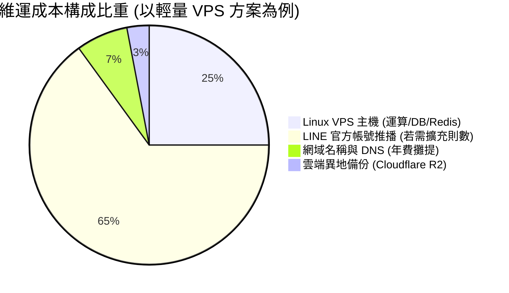

# Stocktify 維運基礎建設與營運成本評估報告
## Infrastructure & Operational Cost Assessment Report

> **專案名稱**：Stocktify (Stock-Ledgery)  
> **評估日期**：2026-10-17  
> **關聯文件**：[Fullstack Architecture & Feature Enhancement Specification (v1.0)](fullstack-optimization-spec.md)  
> **評估目的**：量化分析系統在後端建置上線後的硬體運算、資料庫、快取、推播服務及第三方 API 之各項維運支出，並提供高性價比的最佳落地路徑。

---

## 1. 系統負載與工作量規格分析 (Workload & Sizing)

為提供精準的成本估算，本評估將使用者與資料規模劃分為三個典型階段：

| 評估維度 | 階段一：個人自用 / 內測 (PoC) | 階段二：家庭親友 / 社群 (10~100人) | 階段三：公開營運 / 商業化 (1,000人+) |
| :--- | :--- | :--- | :--- |
| **活躍用戶數** | 1 ~ 5 人 | 10 ~ 100 人 | 1,000 ~ 5,000 人 |
| **交易歷史筆數** | 500 ~ 2,000 筆 | 1 萬 ~ 10 萬 筆 | 50 萬 ~ 200 萬 筆 |
| **盤中即時 QPS** | < 1 req/s | 5 ~ 20 req/s | 50 ~ 200 req/s |
| **API 容器規格** | 0.5 vCPU, 512MB RAM | 1 vCPU, 1GB RAM | 2~4 vCPU (水平擴展 2~4 節點) |
| **PostgreSQL 需求** | 儲存 < 100MB, 512MB RAM | 儲存 1~5GB, 1GB RAM | 儲存 20~50GB, 4GB RAM + Read Replica |
| **Redis 需求** | 128MB RAM | 256MB ~ 512MB RAM | 1GB ~ 2GB RAM |
| **推播訊息量/月** | 150 ~ 300 則 | 1,000 ~ 10,000 則 | 5 萬 ~ 30 萬 則 |

---

## 2. 三大部署方案與成本結構對比 (Cost Scenarios)

---

### 方案 A：極致零成本 / 免費額度方案 (Zero Cost / Free Tier)
適合：個人自用、功能測試、開發驗收階段。

| 基礎服務 | 推薦供應商 | 方案規格與免費額度 | 預估月費 (TWD) | 說明與注意事項 |
| :--- | :--- | :--- | :---: | :--- |
| **前端 Hosting** | **Cloudflare Pages / GitHub Pages** | 無限頻寬、全球 Anycast CDN、自訂網域 + 免費 SSL | **$0** | 靜態 SPA 託管首選，零維運成本。 |
| **後端 API & 排程** | **Render / Fly.io / Koyeb** | 0.25 vCPU, 512MB RAM 免費容器 | **$0** | 閒置 15 分鐘後自動休眠；可用外部 Ping 保活。 |
| **PostgreSQL** | **Supabase Free / Neon** | 500MB 儲存空間、共享運算資源 | **$0** | 500MB 足夠儲存逾 50 萬筆交易，非常寬裕。 |
| **Redis 快取與佇列**| **Upstash Redis** | Serverless Redis，每天 10,000 請求免費 | **$0** | 個人用量每日約 2,000~4,000 次，完全在免費額度內。 |
| **LINE 官方帳號** | **LINE Official Account (免費版)** | 每月免費推播額度 **200 則** | **$0** | 僅自用時，每日 1 則收盤報告 (約 30 則/月) 綽綽有餘。 |
| **外部行情來源** | **Yahoo Finance Proxy** | 透過 Cloudflare Worker 代理 | **$0** | 沿用現行架構，無需數據源月費。 |
| **異地備份** | **Cloudflare R2** | 10GB 儲存免費、免輸出流量費 | **$0** | 每日資料庫 dump 僅數 MB。 |
| **合計** | — | — | **NT$ 0 / 月** | **完全零支出** |

---

### 方案 B：輕量單機 VPS 託管方案 (推薦方案：最佳性價比與可控性)
適合：個人主力投資記帳、家庭多帳號、小型投資社群（10~50人）。

> **架構說明**：透過單一主機利用 `docker-compose.yml` 運行 Nginx (反向代理 + 自動 Let's Encrypt SSL) + Fastify API + BullMQ Worker + PostgreSQL 15 + Redis 7。

| 基礎服務 | 推薦供應商與規格 | 預估月費 (USD / EUR) | 預估月費 (TWD) | 優勢與備註 |
| :--- | :--- | :---: | :---: | :--- |
| **雲端主機 (VPS)** | **Hetzner Cloud (CPX21)** • 3 vCPU AMD EPYC • 4GB RAM • 80GB NVMe SSD • 20TB 流量 | € 7.00 / 月 *(或 CPX11: €4.5)* | **約 NT$ 240 / 月** | 性價比之王，歐洲/美國機房，網路延遲對非高頻交易完全無礙。 |
| *(備選主機)* | **DigitalOcean / Linode** • 2 vCPU, 4GB RAM | $ 24.00 / 月 | 約 NT$ 770 / 月 | 具備新加坡/東京節點，台灣連線延遲低 (<50ms)。 |
| **前端 Hosting** | **Cloudflare Pages** | 免費 | **$0** | 前端維持由全球邊緣節點極速分發。 |
| **網域名稱 (Domain)** | **Namecheap / Cloudflare Registrar** | $ 10.00 / 年 | **約 NT$ 28 / 月** | 自訂網域如 `stocktify.app` 或 `stocktify.tw`。 |
| **異地備份儲存** | **Cloudflare R2 (S3 相容)** | 10GB 內免費 | **$0** | 每日凌晨自動備份資料庫並保留 30 天快照。 |
| **LINE 官方帳號** | **LINE 輕用量方案** *(視需求升級)* • 包含 800~1,000 則訊息 | — | **NT$ 0 ~ 800 / 月** | • 自用 (200則內)：**NT$ 0** • 多人或頻繁推播：**NT$ 800** |
| **合計 (自用型)** | **Hetzner + 免費 LINE 額度** | — | **約 NT$ 270 / 月** | **極致實惠、獨立掌控** |
| **合計 (多人型)** | **Hetzner + LINE 輕用量月費** | — | **約 NT$ 1,070 / 月** | **穩定提供 10~30 人服務** |

---

### 方案 C：全託管雲端 Serverless / PaaS 方案 (高可用高 SLA)
適合：商業運營、對外收費服務、不具備 Linux 系統維運時間的團隊。

| 基礎服務 | 推薦供應商與規格 | 預估月費 (USD) | 預估月費 (TWD) | 優勢與備註 |
| :--- | :--- | :---: | :---: | :--- |
| **前端 Hosting** | **Vercel Pro / Cloudflare Pro** | $ 20.00 | 約 NT$ 640 | 支援進階流量防護、團隊協作。 |
| **API Serverless 運算** | **GCP Cloud Run / AWS ECS** | $ 15.00 ~ 30.00 | 約 NT$ 480 ~ 960 | 依請求自動伸縮 (0 ~ N 節點)，無需修補 OS。 |
| **託管 PostgreSQL** | **Supabase Pro / AWS RDS Postgres** | $ 25.00 | 約 NT$ 800 | 具備自動每日備份、Point-in-Time 還原 (PITR)。 |
| **託管 Redis** | **Upstash Pro / Redis Cloud** | $ 10.00 | 約 NT$ 320 | 全球分佈、自動故障轉移。 |
| **商業行情數據源** | **FinMind 台股 API / Twelve Data** | $ 15.00 ~ 25.00 | 約 NT$ 480 ~ 800 | 官方授權合規行情，無爬蟲被擋風險。 |
| **LINE 官方帳號** | **中用量方案** (4,000 則推播) | — | 約 NT$ 1,200 | 滿足數百人每日即時推播。 |
| **合計** | — | **約 $ 120 ~ 160** | **約 NT$ 3,800 ~ 5,100 / 月** | **零硬體維運、高可用 SLA** |

---

## 3. 關鍵隱形維運成本與風險控制策略 (Cost Drivers & Mitigations)

### 3.1 致命成本因子：LINE 官方帳號推播費用 (Push Message Quota)
- **問題現狀**：LINE 自 2.0 計費模式調整後，主動推播（Push API）費用昂貴。免費方案每個月僅提供 **200 則**；若超過則無法發送或需升級至月費制（輕用量方案約 NT$800、中用量約 NT$1,200，超過後每則訊息更會按階梯計費）。
- **避坑與優化策略**：
  1. **聚合型 Flex Message 圖文卡片**：
     - 嚴格禁止「一檔持股發一則訊息」。
     - 每日收盤只發送「**單一綜合資產快報卡**」，一張卡片內整併：今日總市值、總損益變動、前三大漲跌持股、警示通知。1 個用戶每天僅消耗 1 則額度。
  2. **支援零成本替代推播頻道**：
     - 在後端架構中同時整合 **Telegram Bot** 與 **Discord Webhook**。
     - 這兩大通訊平台之推播為 **完全免費且無則數上限**。重視盤中高頻價格警示（每 5 分鐘巡檢）的用戶可優先選擇 Telegram/Discord，將 LINE 保留給最重要的收盤日報。

### 3.2 外部行情依賴與降級保護
- **問題現狀**：Yahoo Finance 雖然免費，但伺服器 IP 開發頻繁抓取易遭遇 HTTP 429 (Too Many Requests) 或暫時性阻擋。
- **降級與成本保護策略**：
  - **Redis 多層快取防線**：
    - 盤中即時報價：快取 TTL 設為 20~30 秒。
    - 盤後行情：快取 TTL 設為 300 秒。
    - 歷史 K 線與個股資料：快取 TTL 設為 24 小時。
  - **Stale-While-Revalidate 機制**：當外部 API 逾時或回傳異常時，後端立即回傳快取的歷史最後價格並附帶 `stale: true`，不消耗額外對外網路成本，亦不中斷用戶體驗。
  - **未來付費切換線路**：預留台股證交所/櫃買中心 OpenAPI 與 FinMind 介面，未來若商業化可平滑無縫替換。

### 3.3 儲存與備份成本控制
- PostgreSQL 資料庫採用精簡正規化設計（`numeric(20, 8)`、`citext`），每萬筆交易紀錄實體檔案小於 10MB。
- 透過排程腳本每日執行 `pg_dump | gzip`，推送到 Cloudflare R2（提供 10GB 永久免費儲存且不收下載輸出流量費），**儲存維運成本實質為 $0 元**。

---

## 4. 總結與最佳落地路徑建議 (Recommendation)

建議專案依照「**開發期 → 自用驗證期 → 擴展期**」分三步漸進式投入硬體成本：

1. **第一階段（當前開發與本地驗收）**：
   - 支出：**NT$ 0 / 月**。
   - 做法：使用本機 `docker-compose.yml`（本機 PostgreSQL + Redis），前端直連本機後端，零外部伺服器費用。
2. **第二階段（個人上線自用與測試）**：
   - 支出：**約 NT$ 240 ~ 270 / 月**。
   - 做法：租用一台性價比最高的 **Hetzner Cloud VPS (約 €7 / 月)**，部署 Docker Compose 全套環境；LINE 官方帳號使用免費額度（自用每月僅需約 30 則）。
3. **第三階段（對外提供親友或社群公開使用）**：
   - 支出：**約 NT$ 1,000 ~ 1,500 / 月**。
   - 做法：同一台 VPS（升級至 8GB RAM）可輕鬆支撐 50~200 位用戶；主要費用轉為升級 LINE 官方帳號「輕用量月費方案 (NT$800)」，或引導高頻推播用戶使用免費的 Telegram Bot。

---
> 本報告與全端規格書相互印證，已存入專案內部供長期追蹤與架構決策。
